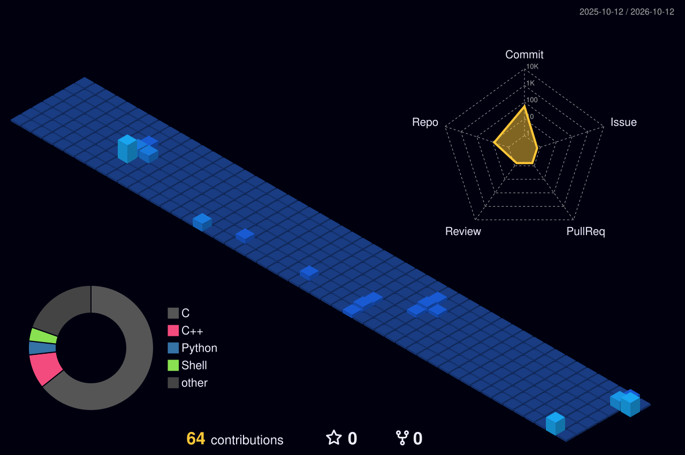

<!-- 🎬 HERO — Silicon & Firmware Identity -->

 

<!-- ⚡ WHAT I BUILD  •  🔬 BEYOND THE LOGIC ANALYZER -->

 

<!-- 🎛️ EMBEDDED TECH ARSENAL & SILICON STACK -->

 

<!-- 🪪 DEVELOPER ID + HARDWARE TELEMETRY DASHBOARD -->

 

<!-- 🧩 SELECTED SYSTEMS & FEATURED BUILDS -->

 

<!-- 📡 LIVING ENGINEERING SIGNALS & ACTIVITY -->

<!--
========================================================================
🌃 3D CONTRIBUTION CITY (SAVED FOR THE FUTURE)
When your commit and contribution volume grows, uncomment the lines below:
------------------------------------------------------------------------

========================================================================
-->

 

<!-- 💌 LET'S CONNECT & COLLABORATE -->

  
  &nbsp;
  
  &nbsp;
  
  &nbsp;
  

  

  <b>From signal to system. Bridging hardware and software through deterministic firmware.</b> ⚡

